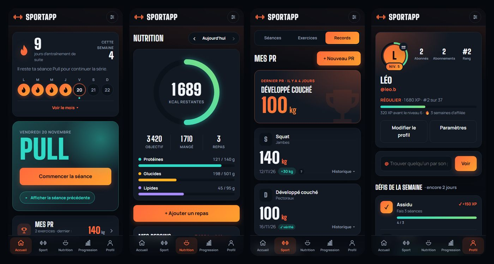

# SportApp 🏋️

**Ton carnet de muscu : séances, PR, calories et défis entre potes.**

👉 **[Ouvrir SportApp](https://zorgue1.github.io/ProjetSite/)** · gratuit, sur téléphone et ordinateur, s’installe comme une appli.



## Fonctionnalités

- **Séances** : programme de la semaine (Push / Pull / Leg ou personnalisé), séries, charges, notes et série de jours d’entraînement.
- **Records** : PR sur 1 répétition et meilleures séries par exercice, avec un 1RM estimé.
- **Nutrition** : besoins en calories et en macros calculés à partir du profil, journal des repas et anneau qui passe au rouge en cas d’excès.
- **Progression** : courbes de poids et de charges, calendrier de régularité, répartition des séances et des muscles travaillés.
- **Profil et défis** : XP, niveaux, badges, défis de la semaine, abonnés et abonnements, classement entre amis et comparaison des PR.
- **Compte** : pseudo unique, photo de profil, confirmation par e-mail, mot de passe oublié.
- **Appli installable (PWA)** : thème clair ou sombre, utilisable hors connexion pour les pages déjà ouvertes.

## Technologies

| Partie | Outils |
|---|---|
| Interface | HTML, CSS, JavaScript (sans framework) |
| Base de données et comptes | [Supabase](https://supabase.com) : PostgreSQL, authentification, stockage des photos |
| Hébergement | GitHub Pages |
| Appli mobile | PWA (manifest et service worker) |

## Sécurité

- Chaque utilisateur ne voit que ses propres données : règles de sécurité (RLS) sur toutes les tables.
- L’XP et la vérification des PR sont calculées par le serveur, pour qu’on ne puisse pas tricher depuis l’appli.
- Mots de passe d’au moins 8 caractères avec lettres et chiffres. Changer son mot de passe déconnecte les autres appareils.
- Bibliothèque Supabase de version figée et vérifiée par empreinte, politique de sécurité du contenu (CSP) sur chaque page.

## Organisation du code

```
index.html      page d’accueil publique
HTML/           pages de l’appli (Accueil, Séances, Records, Nutrition, Progression, Profil…)
CSS/            un fichier par page + Commun.css et Couleur.css (thèmes)
JS/             donnees.js (accès aux données), entete.js (navigation), supabase.js (connexion)
Image/          icônes et images
sw.js           service worker (fonctionnement hors connexion)
```

## Auteur

Projet personnel développé par [zorgue1](https://github.com/zorgue1).
Photo de la page d’accueil : Victor Freitas sur Unsplash.
